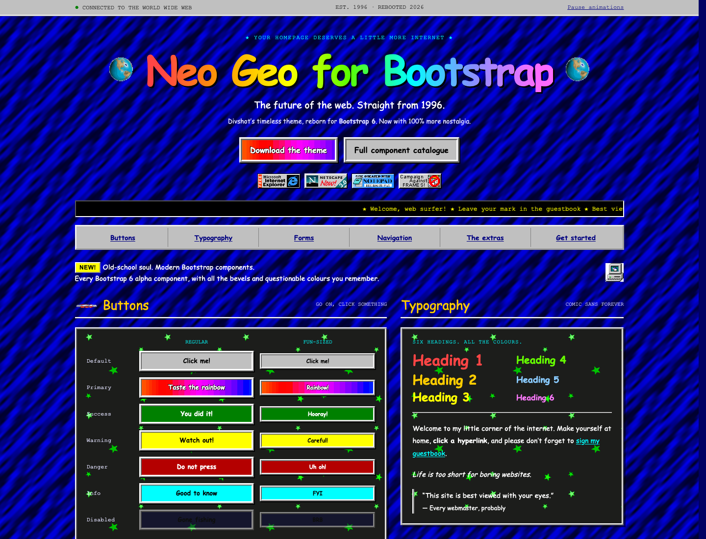

<div align="center">


# Neo Geo Bootstrap

**The future of the web. Straight from 1996.**

Divshot’s gloriously retro Geo theme, rebuilt for Bootstrap 6.


[Live demo](https://neo-geo-bootstrap.lakebed.app) · [Component catalogue](https://neo-geo-bootstrap.lakebed.app/gallery) · [Original Geo](https://github.com/divshot/geo-bootstrap)

</div>

[](https://neo-geo-bootstrap.lakebed.app)

## Welcome back to the World Wide Web

Rainbow buttons. Spinning globes. Tiled backgrounds. Comic Sans everywhere.

Neo Geo Bootstrap brings [Divshot’s original Geo theme](https://github.com/divshot/geo-bootstrap) to **Bootstrap 6.0.0-alpha.1**, including its newer components. It keeps the original textures and GIFs, with responsive layouts, keyboard interaction, and a way to pause the decorative animations.

The visitor counter is fake. The nostalgia is real.

## Take it for a spin

Visit the **[live demo](https://neo-geo-bootstrap.lakebed.app)** for the classic Geo experience, or explore the **[full component catalogue](https://neo-geo-bootstrap.lakebed.app/gallery)** for forms, menus, calendars, dialogs, and more.

Use **Download the theme** on the demo to get the stylesheet, assets, license notices, and two ready-to-open offline demos. Unzip the download and open `index.html` or `gallery.html`.

## Make your site a little more 1996

Copy the `theme/` directory from the download into your site. Load Bootstrap first, then Geo:

```html
<link rel="stylesheet" href="bootstrap.min.css">
<link rel="stylesheet" href="theme/geo-bootstrap.css">
```

Keep `theme/img/` beside the stylesheet. In this repository, the reusable theme lives in [`public/theme/`](public/theme/).

Use Bootstrap 6’s component markup:

```html
<button class="btn-solid theme-primary">Taste the rainbow</button>
<button class="btn-solid theme-success">You did it!</button>

<div class="alert theme-warning" role="alert">
  This homepage is eternally under construction.
</div>
```

Interactive components use Bootstrap’s own JavaScript plugins. An optional [focus helper](public/theme/geo-bootstrap.js) normalises opened dialog, drawer, and clicked menu focus across browsers:

```js
import { installGeoEnhancements } from './theme/geo-bootstrap.js';

installGeoEnhancements();
```

The theme applies globally to the page that loads it.

## The whole toolkit, with extra bevels

Coverage is checked against the installed release: **53 style modules and all 20 exported JavaScript plugins**.

| Area | Included |
| --- | --- |
| The classics | Typography, buttons and groups, cards, tables, badges, alerts, progress, lists, images |
| Forms | Inputs, validation, checks, radios, switches, floating labels, input groups, adorned controls, selection cards |
| Newer controls | Searchable and multiple comboboxes, chips, chip inputs, datepickers, OTP inputs, strength meters, range bubbles and ticks |
| Navigation | Navbars, tabs, pills, breadcrumbs, pagination, overflow menus, nested menus, scrollspy, collapse |
| Overlays | Native dialogs, drawers, bottom sheets, tooltips, popovers, toasts |
| More internet | Avatars and status, steppers, carousels, placeholders, spinners, original Geo graphics |

Bootstrap’s helpers, utilities, responsive layouts, and data APIs remain available. Geo styling uses the framework’s `custom` CSS layer so utility classes can still take precedence.

See the [coverage report](public/coverage.md) for the module inventory, verification scope, and known upstream behavior.

## Fire up the development server

From a checkout of this repository:

```sh
npm ci
npm run dev
```

Open the URL printed by Vite. `index.html` is the showcase; `gallery.html` is the full catalogue.

| Command | What it does |
| --- | --- |
| `npm run dev` | Run the demos locally |
| `npm run audit` | Compare coverage with Bootstrap’s shipped style modules and plugins |
| `npm run build` | Build the site and `artifacts/neo-geo-bootstrap.zip` |
| `npm test` | Run the Chromium and WebKit browser checks |
| `npm run build:lakebed` | Prepare the Lakebed deployment snapshot |

Install the browser test engines once with `npx playwright install chromium webkit`. The [development guide](docs/DEVELOPMENT.md) covers the focus helper, packaging, hosting, and optional Firefox checks.

## Compatibility & verification

- **Pinned to Bootstrap `6.0.0-alpha.1`.** Later alphas may change APIs; Bootstrap 5 is outside this port’s target.
- **32 browser checks passed in Chromium and WebKit**, covering desktop/mobile layouts, component interactions, utility precedence, and offline demos. This is a local verification result, not a GitHub CI status.
- **Firefox is unverified.** Its installed headless test browser could not launch on the development Mac.
- **One upstream alpha diagnostic remains:** Bootstrap’s combobox reports a duplicate instance when creating its internal menu. Search, multiple selection, empty results, and keyboard dismissal are tested. Bootstrap’s source is unmodified.

Every shipped component family has an example. The regression suite checks representative states and interactions; it does not exhaust every combination of upstream options.

## A few things to know

The demo guestbook saves messages in your browser when you select its save option. It has no shared backend. The counter and vintage browser badges are decorative.

The demo and downloadable theme use local assets, with no remote fonts or CDN requirements. The pause control and reduced-motion preference stop the ticker and animated backgrounds and hide decorative animated images. Those old browser badges are souvenirs, not support guarantees.

## Built on a wonderfully weird original

**Geo was created by [Divshot](https://github.com/divshot/geo-bootstrap).** Its original theme, textures, and GIFs made this revival possible. The original MIT notice is preserved in [`public/legacy/LICENSE`](public/legacy/LICENSE) and in the download.

Neo Geo Bootstrap is an independent port. It is not an official Divshot or Bootstrap release. Historical third-party logos remain their respective owners’ marks.

Neo Geo Bootstrap is released under the [MIT License](LICENSE), the same licence used by [Divshot’s original Geo theme](public/legacy/LICENSE). The original copyright and licence notices are retained. Bootstrap, the calendar integration, and Floating UI license notices are included in the download.

<div align="center">

**Made with love, Comic Sans, and absolutely no restraint.**

[Visit the homepage](https://neo-geo-bootstrap.lakebed.app) · [Surf the catalogue](https://neo-geo-bootstrap.lakebed.app/gallery)

</div>
